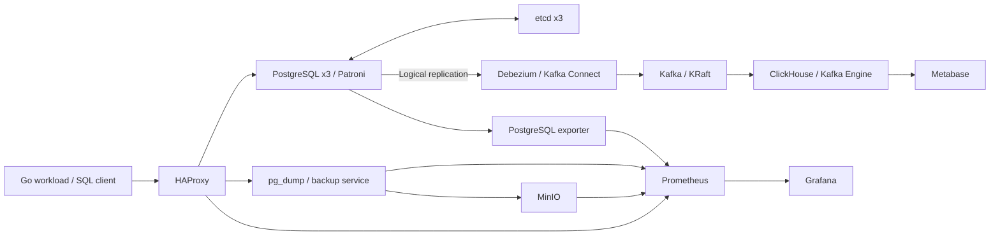

# PostgreSQL HA & CDC Lab


Инфраструктурный проект на базе PostgreSQL: кластер с автоматическим выбором primary, резервное копирование в MinIO, профилирование SQL под нагрузкой и поток изменений **PostgreSQL → Debezium → Kafka → ClickHouse → Metabase**.

Предметная область — интернет-магазин фруктов: пользователи, товары, поставщики, складские остатки, заказы, оплаты и доставки. Go-сервис создаёт OLTP/OLAP-нагрузку через HTTP API, чтобы исследовать производительность и поведение базы при отказах.

## Что реализовано

- **Высокая доступность:** три PostgreSQL-узла под Patroni, три узла etcd для координации и HAProxy как точка подключения к primary.
- **Работа с данными:** схема в DBML, 12 SQL-миграций Goose и генератор тестовых данных на Go.
- **Профилирование:** `pg_stat_statements`, `EXPLAIN (ANALYZE, BUFFERS)`, k6 и сохранённые результаты трёх этапов нагрузки.
- **Оптимизация SQL:** составные индексы, переписывание запросов и материализованное представление продаж по дням и категориям.
- **Резервное копирование:** `pg_dump`, хранение в MinIO, retention, скрипт восстановления и собственный Go-exporter состояния бэкапов.
- **Наблюдаемость:** Prometheus, PostgreSQL exporter, Grafana-дашборды для базы, бэкапов, SQL и отказоустойчивости.
- **CDC и аналитика:** Debezium захватывает изменения `order_event_log`; ClickHouse Kafka Engine и materialized view обрабатывают snapshot, INSERT, UPDATE и DELETE; BI views предназначены для Metabase.
- **Сценарии отказов:** инструкции для проверки отказа primary и потери DCS с помощью Pumba.

## Архитектура



HAProxy выбирает primary по REST API Patroni. Debezium подключается через тот же адрес `db:5432`. В ClickHouse хранятся версии событий, а BI views выбирают актуальную версию и исключают удалённые записи.

## Быстрый запуск

Нужны Git и Docker с Compose v2 и Linux-контейнерами. На Windows подходит Docker Desktop. Первый запуск собирает Go-приложения и скачивает образы.

```bash
git clone https://github.com/l3ssthanthree/postgres-ha-cdc.git
cd postgres-ha-cdc
cp .env.example .env
docker compose up --build -d
docker compose ps
```

В PowerShell вместо `cp` можно использовать `Copy-Item .env.example .env`.

`.env.example` содержит согласованные **публичные демонстрационные пароли** для локального стенда. Реальный `.env` исключён из Git и Docker build context. Имена CDC-роли, publication, topic и аналитической БД также используются в SQL и конфигурации коннектора: при их изменении обновляй связанные файлы. Миграция `012` задаёт демонстрационный пароль роли `fruits_debezium`, а ClickHouse init SQL — пароль `metabase_ch`.

Дождись завершения `migrator` и готовности Kafka Connect, затем зарегистрируй коннектор:

```powershell
.\bi\debezium\register.ps1
```

Для Linux / WSL / Git Bash:

```bash
sh bi/debezium/register.sh
```

Проверь API и CDC:

```bash
curl http://localhost:8080/healthz
curl http://localhost:8083/connectors/postgres-connector/status
docker compose exec -T clickhouse clickhouse-client --query "SELECT * FROM fruits_bi.v_bi_order_event_kpi FORMAT Vertical"
```

Если Kafka Connect ещё не готов, повтори регистрацию после проверки `docker compose logs kafka-connect`. Регистрация идемпотентна: скрипт использует `PUT`.

### Интерфейсы

| Сервис | Адрес / порт | Назначение |
| --- | --- | --- |
| PostgreSQL через HAProxy | `localhost:5432` | Подключение к текущему primary |
| Workload | `http://localhost:8080/healthz` | Проверка Go-сервиса |
| Grafana | `http://localhost:3000` | Метрики и дашборды |
| Prometheus | `http://localhost:9090` | Сбор метрик |
| HAProxy | `http://localhost:7000` | Состояние PostgreSQL backend-ов |
| Patroni REST API | `localhost:8008`, `8009`, `8010` | Состояние и роли узлов |
| MinIO Console | `http://localhost:9001` | Резервные копии |
| Kafka Connect | `http://localhost:8083` | Регистрация и состояние Debezium |
| Kafka UI | `http://localhost:8084` | Просмотр CDC-топика |
| ClickHouse HTTP | `http://localhost:8123` | Аналитические запросы |
| Metabase | `http://localhost:3001` | BI-визуализации |

Логины Grafana и MinIO заданы в `.env.example`. Администратора Metabase создай при первом запуске; настройка подключения к ClickHouse и BI-карточек описана в [руководстве по CDC и BI](bi/README.md). Если ClickHouse отсутствует в списке типов БД Metabase, потребуется совместимый драйвер в `metabase/plugins/`.

## Результаты оптимизации

Ниже приведены **сохранённые измерения учебного стенда**, а не новый запуск. Сравниваются этап 2 с усложнённой схемой/запросами и этап 3 после оптимизации. Значения — p95 длительности HTTP-запросов k6; они зависят от данных, нагрузки и оборудования.

| Сценарий | До, мс | После, мс | Снижение p95 | Изменение |
| --- | ---: | ---: | ---: | --- |
| Последние заказы | 1762.37 | 117.01 | 93.4% | Переписывание SQL и индекс по `(order_id, created_at DESC)` |
| Наличие товара | 6396.91 | 122.70 | 98.1% | Индекс истории цен по `(product_id, created_at DESC)` |
| Продажи по дням | 494.69 | 38.57 | 92.2% | Материализованное представление |

Исходные JSON, статистика PostgreSQL и планы запросов находятся в [profiling/](profiling/README.md). Там же приведено сравнение всех шести эндпоинтов и отдельная проверка влияния индексов на запись.

## HTTP API нагрузки

| Метод | Путь | Сценарий |
| --- | --- | --- |
| GET | `/healthz` | Проверка доступности |
| GET | `/api/oltp/orders/recent` | Последние заказы с данными связанных таблиц |
| GET | `/api/oltp/inventory/availability` | Остатки и актуальная цена |
| POST | `/api/oltp/orders/status` | Обновление статуса заказа |
| GET | `/api/olap/sales/daily` | Продажи по дням и категориям |
| GET | `/api/olap/customers/top` | Агрегация по клиентам |
| POST | `/api/logs/events` | Пакетная запись событий |

Сценарии k6 находятся в [load/k6_script.js](load/k6_script.js); инструкции и параметры — в [отчёте о профилировании](profiling/README.md).

## Проверка failover

```bash
docker compose exec -T patroni1 patronictl -c /etc/patroni/patroni.yml list
```

Определи текущий `Leader`, останови именно его (`docker compose stop patroni1`, если лидер — `patroni1`) и повторно посмотри список через оставшийся узел. Затем проверь подключение к primary через HAProxy и верни остановленный узел командой `docker compose start patroni1`.

Пошаговые команды, метрики и сценарий потери etcd описаны в [chaos/README.md](chaos/README.md). Pumba-сценарии меняют состояние контейнеров; запускай их на этом локальном стенде.

## Структура

```text
patroni/             PostgreSQL + Patroni image и bootstrap
haproxy/             маршрутизация к primary и метрики
migrations/          схема, индексы, materialized view и CDC publication
cmd/seed/            генератор тестовых данных на Go
workload/            Go HTTP-сервис и SQL для нагрузки
load/                сценарии k6
profiling/           планы запросов, метрики и отчёт
backup_exporter/     Go-exporter состояния резервных копий
scripts/backup/      создание, retention и восстановление бэкапов
monitoring/          Prometheus и Grafana
bi/                  Debezium-коннектор, smoke SQL и BI-инструкции
clickhouse/          обработка CDC и аналитические views
chaos/               сценарии проверки отказоустойчивости
docs/                исходное описание модели данных и HA
schema.dbml          модель данных
```

## Проверки и границы проекта

GitHub Actions выполняет `go vet`, сборку Go-пакетов, проверку JSON, синтаксиса shell-скриптов и `docker compose config`. Эти проверки не запускают весь кластер и не подтверждают end-to-end CDC или failover. Для этого предусмотрены ручные сценарии в `bi/` и `chaos/`.

Стенд предназначен для обучения и локальных экспериментов: Kafka состоит из одного брокера, часть Docker-образов использует `latest`, сервисы публикуют порты и используют демонстрационные пароли. У PostgreSQL нет включённого синхронного режима репликации; при отказе primary возможна потеря последних подтверждённых записей. Непрерывность CDC при переключении primary требует отдельной проверки logical slot и позиции WAL.

Обычная остановка: `docker compose down`. Команда `docker compose down -v` дополнительно удаляет данные именованных томов.

## История проекта

Автор: **Даниил Казанович** · [GitHub](https://github.com/l3ssthanthree).

Проект развивался в учебном [репозитории GitLab ИТМО](https://gitlab.sqlwars.ru/dbd26/M3209_KazanovichDO/-/tree/lab1). Эта публикация сохраняет историю коммитов и основана на ветке `lab1`, коммит `c2ac4d4672b9294a09cbb81ac7a01e428af6413b`. В архиве была более ранняя версия `92d5bab`; этап CDC/BI взят из актуального GitLab. Исходное описание предметной области сохранено в [docs/data-model-and-ha.md](docs/data-model-and-ha.md).
